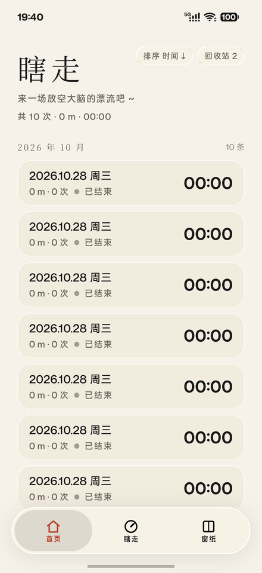
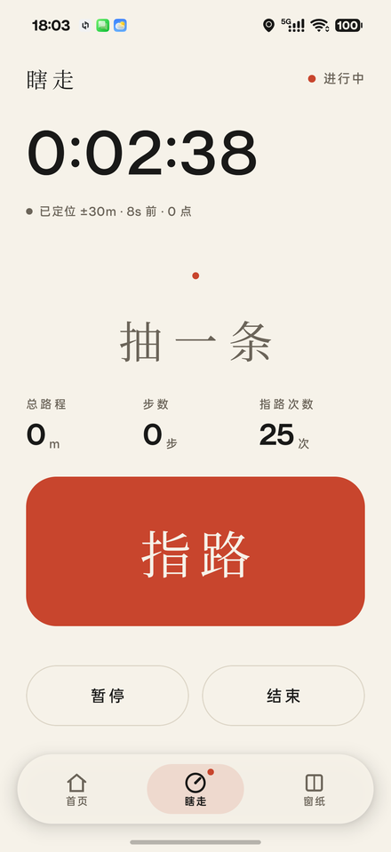
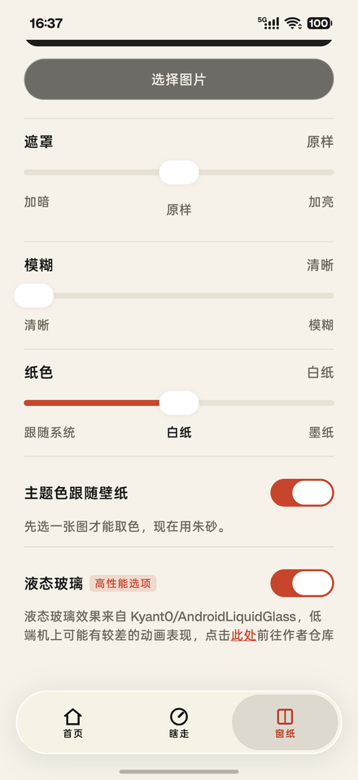
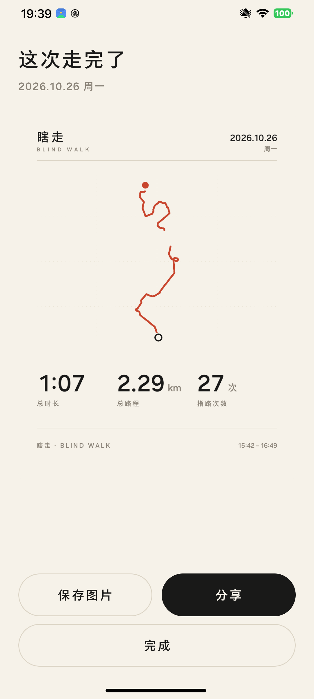

# 瞎走 · Blind Walk

> 你按下按钮，它给你一个方向。你走，它记录。走完给你一张卡片。

一个把「往哪走」这个决定外包给随机数的 Android 应用。没有地图、没有导航、没有账号、没有网络——只有一个大按钮、一条 GPS 轨迹，和一张可以发出去的总结卡片。

<p align="center">
  
  
  
</p>
<p align="center">
  
</p>

---

## 它是什么

**核心循环**

```
开始行程
   ↓
[循环]  按下「指路」 ──→ 加权随机出「前进 / 左转 / 右转 / 掉头」
   ↓                        ↓
   │                   震动 + 大字显示
   │                        ↓
   │                你自己判断怎么转、走多远
   └───── 后台持续采点、计时、累计路程 ─────┘
   ↓
暂停（可多次）/ 继续
   ↓
结束行程
   ↓
1080×1440 总结卡片 ──→ 存相册 / 系统分享面板 → 任意社交软件
```

**给谁用**

| 场景 | 诉求 |
| --- | --- |
| 城市漫游者 | 下班后想在熟悉的街区走出一条从没走过的路线 |
| 旅行者 | 到了陌生城市，不想看攻略，想被随机带走 |
| 内容创作者 | 需要一张「我今天走了 7.4 公里」的可分享卡片 |
| 选择困难 | 把「往哪走」这个决策交出去 |

设计上不预设用户会盯着屏幕：**抬手机看一眼 → 按一下 → 放下**。所以指令必须大字、高对比、无歧义。

---

## 功能

### 行程

- **加权随机指令**：前进 / 左转 / 右转 / 掉头 = 40 / 26 / 26 / 8，用户主动触发，不自动推送
- **真实暂停**：停定位、停计时、断轨迹，恢复后轨迹自动分段，卡片上能看出断口
- **进程被杀能自愈**：前台服务 + `START_STICKY` + 每 3 秒落盘，重启后接着记录
- **静止不计里程**：锚点位移门限 `max(5m, 精度×0.6)` **外加**加速度计静止判定——室内 ±30m 的网络定位不会把里程刷起来
- **自适应采样**：静止时定位间隔自动从 1s 放宽到 5s
- **计步**：走系统的 `STEP_COUNTER`，没有传感器就不显示这一栏，不造假 0

### 历史

- 按月分组、按时间 / 距离 / 次数排序，表头内联切换（不是弹窗）
- 进行中的记录实时走字，点击直接回到行程页；左滑是「暂停 / 结束」而不是删除
- 已结束的记录左滑多选 / 移入回收站，右滑置顶
- 回收站支持恢复与彻底删除

### 卡片

- 1080×1440，Canvas 直绘（不用 Compose 截图，避免缩放出锯齿）
- 轨迹投影带真实断口，页脚记录起止时间、距离、步数、指令次数
- 存相册 + 系统分享面板，不接任何第三方 SDK

### 外观（窗纸）

- 支持自定义壁纸、纸色、模糊、蒙层浓度
- **液态玻璃**：基于 [`io.github.kyant0:backdrop`](https://github.com/Kyant0/AndroidLiquidGlass) 的折射 / 色散 / 高光，底栏、按钮、弹窗、滑块都是真玻璃
- 主题色可从壁纸取主色
- 关掉玻璃时退回纯纸底，行为一致

---

## 设计上刻意不做的事

这些不是没做完，是产品边界：

| 不做 | 原因 |
| --- | --- |
| 定时 / 定距自动下发指令 | 指令必须由用户主动触发，否则变成导航 |
| 识别用户「实际转向」是否正确 | 不接罗盘/磁力计，走错也是走 |
| 地图 SDK、路线规划、导航语音 | 零联网是产品承诺，不是技术限制 |
| 云端同步、账号体系、社交 feed | 数据不出设备 |
| 微信 / QQ 开放平台 SDK | 系统分享面板已经够用，少一个依赖少一份隐私风险 |
| Room | 文件式持久化足够，且崩溃后更容易自证状态 |

---

## 技术栈

| 组件 | 版本 |
| --- | --- |
| Kotlin | 2.3.21 |
| AGP | 9.4.1（内置 Kotlin 支持，不再单独应用 `kotlin.android`） |
| Gradle | 9.8.2 |
| JDK | 21（`jvmTarget = 17`） |
| Compose UI | 1.12.0 |
| Material3 | 1.4.0 |
| compileSdk / targetSdk / minSdk | 37 / 36 / 33 |
| 液态玻璃 | `io.github.kyant0:backdrop:2.0.1` |

单 Activity + 字符串路由（不引 Navigation），状态全部走 `StateFlow` + `AndroidViewModel`。

---

## 项目结构

```
.
├── README.md
├── 任务书.md                    ← 完整规格：ADR、数据契约、状态机、验收标准
├── docs/screenshots/            ← README 用的截图
└── android/
    ├── build.cmd                ← 构建入口（自动处理中文路径，见下）
    ├── build.ps1
    └── app/src/main/java/com/blindwalk/app/
        ├── data/                ← 文件式持久化（原子写 + JSONL + 元数据缓存）
        ├── domain/
        │   ├── geo/             ← 距离计算、轨迹投影
        │   ├── history/         ← 排序 / 分组 / 统计
        │   ├── model/           ← SessionRecord、TrackPoint
        │   ├── random/          ← 加权随机指令
        │   └── session/         ← 会话状态机
        ├── location/            ← 前台定位服务、计步、静止判定
        ├── card/                ← Canvas 卡片渲染与导出
        └── ui/                  ← Compose 页面、玻璃组件、主题
```

---

## 构建

```powershell
cd android
.\build.cmd                    # debug APK
.\build.cmd assembleRelease    # release APK（R8 + 资源压缩）
.\build.cmd testDebugUnitTest  # 单元测试
```

产物：

- `android/app/build/outputs/apk/debug/app-debug.apk`
- `android/app/build/outputs/apk/release/app-release.apk`

### 为什么必须用 `build.cmd`

工程路径带中文时，直接 `gradle assembleDebug` 会出现「编译能过、测试工作进程 `ClassNotFoundException`」——JDK 21 在 Windows 上以系统 ANSI 编码解析 Gradle 的 `@argfile`，中文路径被截断。

`build.ps1` 用 `subst` 把工程映射到一个空闲的纯 ASCII 盘符后再构建，彻底绕开。脚本还会自动推导 `JAVA_HOME`（要 JDK 根目录，不是 `bin\java.exe`）。

---

## 验证状态（1.0.0）

| 项 | 结果 |
| --- | --- |
| `assembleRelease` | ✅ APK **3.29 MB**（debug 未混淆约 29 MB） |
| `testDebugUnitTest` | ✅ **50 / 50** 通过 |
| 权限表 | 6 项，**不含 `INTERNET`**；不含后台定位、不含存储权限 |
| 前台服务 | ✅ `types=0x00000008`（LOCATION） |
| 静止不计里程 | ✅ 静止 2 分钟里程稳定 0 m |
| 自适应采样 | ✅ 静止 30 秒后注册间隔 1s → 5s |
| 真机主流程 | ✅ 抽签 / 暂停 / 结束 / 卡片 / 存相册 / 系统分享 / 断线 / 冷启动自愈 |

真机验证机型：Redmi K60 Ultra（1080×2354，Android 17 / API 37）+ 一台 1080×2400 机型做适配回归。

> **注意**：当前 release 用 debug 密钥签名，仅供本机安装验证。要分发请自行配置正式签名。

---

## 隐私

- 完全离线，**不声明 `INTERNET` 权限**，任何数据不出设备
- 位置只用于本次行程的里程与轨迹，不上传、不共享
- 所有记录保存在应用私有目录，卸载即删除
- 权限只在点「开始瞎走」时请求，不在冷启动时弹框

---

## 文档

完整规格在 [`任务书.md`](任务书.md)：架构决策记录（ADR）、数据契约、状态机、随机算法、定位过滤规则、卡片栅格、边缘场景矩阵、验收标准。

---

## 已知限制

- 计时用墙钟，用户手动改系统时间会导致时长跳变（单调时钟未实现）
- 长时户外骑行（2 小时以上）的耗电与轨迹精度未做压力测试
- release 未使用正式签名

---

## License

MIT
